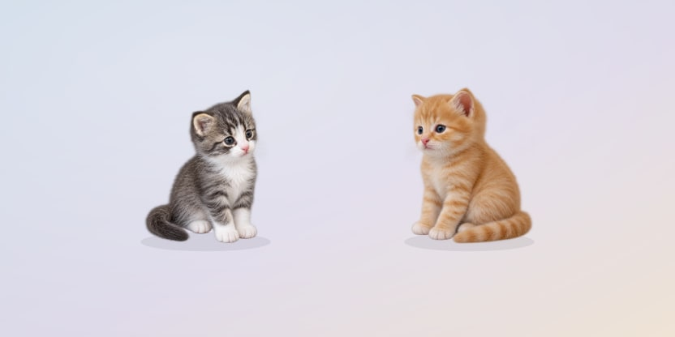
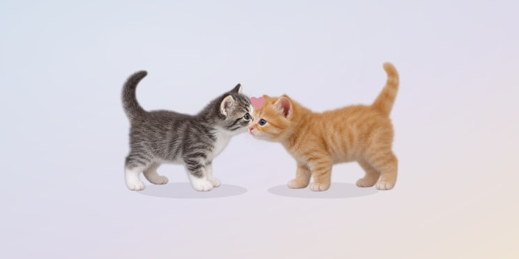
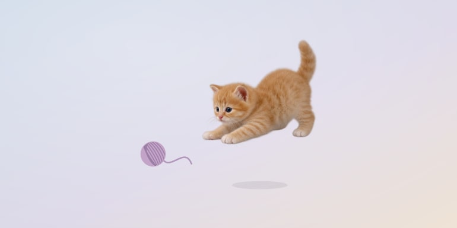
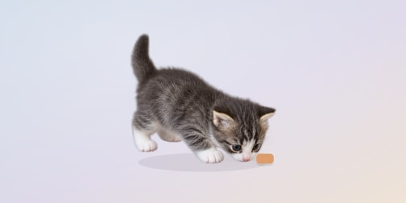
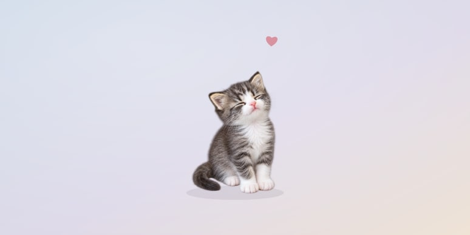
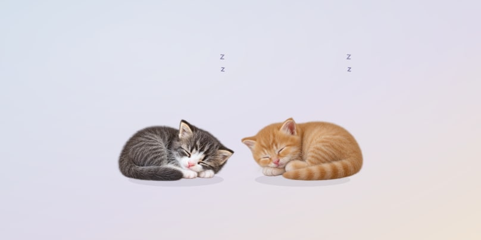
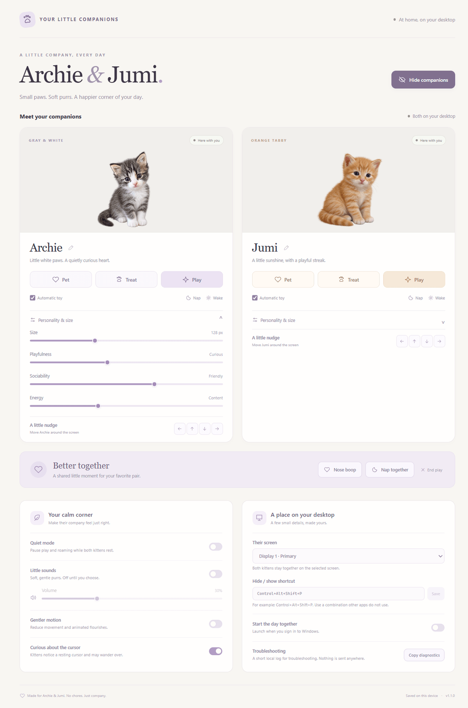

# Archie-Jumi

**Desktop Kitten Companions.** Two photo-realistic kittens, gray-and-white Archie and orange tabby Jumi, live on your Windows desktop. They wander, groom, nap, chase yarn, eat treats and lean into a pet, while every click away from them still reaches the apps underneath.



## What they do

<table>
  <tr>
    <td width="50%"><br><b>Nose boop.</b> Now and then the two meet nose to nose, and a little heart pops up.</td>
    <td width="50%"><br><b>Yarn play.</b> A kitten chases the ball, crouches and pounces. You can pick the ball up and move it.</td>
  </tr>
  <tr>
    <td width="50%"><br><b>Treats.</b> A treat drops in front of the kitten, who walks over and eats it, leaving a few crumbs.</td>
    <td width="50%"><br><b>Petting.</b> Click for a quick pet, or press and hold for a longer one with hearts and a soft purr.</td>
  </tr>
  <tr>
    <td width="50%"><br><b>Naps.</b> They doze off on their own, or together when you ask, and wake up with a stretch.</td>
    <td width="50%">They also look around, groom, sit near the bottom of the screen, and get curious: rest the pointer near an idle kitten for a couple of seconds and it turns to look, and sometimes walks over.</td>
  </tr>
</table>

## How it works

### On your desktop

The kittens live in a transparent layer above your windows on one monitor. Only the kittens and the yarn catch the mouse. Everywhere else, clicks, scrolling and dragging go straight to the window underneath, and the kittens never take keyboard focus, so you can keep working while they play.

Left alone, they rest, wander, groom and nap, and the two sometimes seek each other out. Each kitten has its own personality: playful kittens pounce and chase more, sociable ones visit each other and the pointer more, and energetic ones wander more and sleep less.

### Playing with them

| Do this | What happens |
| --- | --- |
| Click a kitten | A short pet: closed eyes, a rising heart and, if sounds are on, a purr. |
| Press and hold a kitten | A longer pet, up to eight seconds, with hearts and a looping purr. |
| Drag a kitten | Carry it anywhere on the screen. It swings a little and lands softly where you let go. |
| Right-click a kitten | Pet, **Come here**, Give a treat, Play with yarn, Automatic yarn play, Nap, Wake, Reposition and Hide. |
| Drag the yarn | Lead the chase. Automatic yarn play rolls the ball by itself, and play ends after 30 seconds or with End play. |
| **Come here** | From a kitten's menu, choose it, then point at a spot and hold the pointer still for a moment. From the tray menu, the kitten walks to where the pointer last rested on the desktop. |

The tray icon menu has Show/Hide All, Quiet Mode, each kitten's actions, End Play, monitor selection, Settings and Quit. Double-click the tray icon to open Settings. **Ctrl+Alt+Shift+P** hides or shows both kittens; you can change the shortcut in Settings. Closing Settings leaves the kittens running, so use Quit in the tray menu to close the app.

### Settings



- **Each kitten:** rename it with the pencil, pet it, give a treat, start play, put it to sleep or wake it, and move it with the arrow buttons. **Personality & size** sets its size and how playful, sociable and energetic it is.
- **Better together:** start a nose boop or a nap together, or end play.
- **Your calm corner:** **Quiet mode** settles both kittens near the bottom of the screen and makes them fully click-through. **Little sounds** turns on the purrs (off by default) with a volume slider. **Gentler motion** removes roaming, leaps and animated flourishes. **Curious about the cursor** turns the pointer curiosity on or off.
- **A place on your desktop:** choose the monitor, change the hide/show shortcut, start the kittens when you sign in to Windows (installed app only), and **Copy diagnostics** for troubleshooting.

### Privacy

The app runs entirely offline: no account, no telemetry, no internet connection. It never takes screenshots of your desktop, reads other windows or records your keyboard. It checks where the pointer is only to notice when you reach a kitten; the position stays in memory and is never saved or sent. Settings and a small troubleshooting log stay in the app's data folder on your PC, and the log is copied to the clipboard only when you click Copy diagnostics.

## Install

The app runs on Windows 11 x64. There is no prebuilt download yet; build it with Node.js 24 LTS:

```powershell
cd archie-jumi-app
npm ci
npm start        # run from source
npm run make     # build the installer
```

`npm run make` creates `archie-jumi-app/out/make/squirrel.windows/x64/ArchieJumiSetup.exe`. The installer is unsigned, so Windows SmartScreen may ask you to confirm before it runs. Installing a newer version upgrades in place and keeps your settings.

## Documentation

- [App README](archie-jumi-app/README.md): controls in detail, troubleshooting, development commands and architecture.
- [Release notes](archie-jumi-app/docs/release-notes.md): what changed in each version (current: 1.1.0).
- [Validation record](archie-jumi-app/docs/VALIDATION.md): what was tested, and what is still open.
- [Upgrade plan](archie-and-jumi-upgrade-plan.md): the plan behind versions 1.0.2 and 1.1.0.
- [Art direction](archie-jumi-app/docs/art-direction.md) and [Phase 3 art prompts](archie-jumi-app/docs/phase3-art-prompts.md): how the kitten artwork is made and how to add more poses.

The kitten artwork is AI-generated from photos of the real Archie and Jumi; the original photos are not part of this repository. The screenshots above come from the app's own windows (`npm run screenshots`), with the kittens shown on a neutral background.
