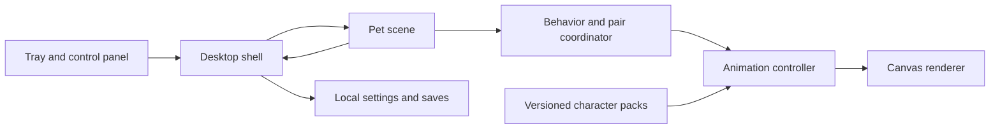

# Archie & Jumi — Desktop Pet App Blueprint

Version 1.1 · Windows-first personal companion app

**Appearance amendment, October 17, 2026:** The user requested realistic photo-based profiles instead of illustrated/cartoon kittens. App version 1.0.1 applies this direction to the profile cards and desktop sprite packs. The product behavior and architecture below remain the agreed baseline; references to the original illustrated style are superseded by this amendment. Generated views of unseen markings remain interpretations.

This document records the agreed product and engineering blueprint. Implementation evidence and remaining native-device checks are tracked separately in the release notes; targets here are requirements, not performance claims.

## 1. Vision and boundaries

Create a personal desktop app where recognizable illustrated versions of Archie and Jumi live over everyday applications. They should feel affectionate, entertaining, and easy to quiet or hide.

| Decision | Specification |
| --- | --- |
| Archie | Gray-and-white tabby; white facial blaze, muzzle, chest and paws; pink nose. Reference photo ends `10_26_53 PM.jpg`. |
| Jumi | Fluffy orange tabby; rounded face, pale muzzle, pink nose and light paw tips. Reference photo ends `10_27_00 PM.jpg`. |
| Art | Soft illustrated 2D, consistent coat markings and kitten proportions. |
| Personality | Editable fictional defaults: gently curious Archie; more bouncy and playful Jumi. |
| V1 audience | Personal use on supported Windows 11 x64. |
| Platform strategy | Windows first; later macOS and Linux ports through a desktop adapter. |
| Runtime | Entirely offline. No account, cloud dependency, telemetry, screenshot inspection, global key recording or reference-photo uploads. |
| Desktop | One selected monitor; both kittens share a transparent overlay. Primary monitor is the initial default. |
| Defaults | Sound muted; launch at login disabled; size 128 logical pixels. |
| Desktop physics | The screen is a flat play surface. Release places a kitten where dropped. No gravity, window climbing or reading other application contents. |

No hunger penalties, illness, daily chores, AI conversation, notifications or progression systems belong in V1. Absence never causes distress or lost progress.

Forward compatibility means versioned assets and saved state, separation of behavior from rendering and platform APIs, dependency maintenance and upgrade tests. It does not guarantee that every future OS preserves overlay behavior.

## 2. Interaction and behavior

### Individual activities

Kittens intermittently rest, look around, walk, groom and sleep. Personality adjusts activity frequency and timing, using the same action vocabulary. Ordinary behavior is gentle rather than constant movement.

| Input | Result |
| --- | --- |
| Click kitten | Approximately two-second affectionate response, closed eyes, subtle heart and optional purr. |
| Drag kitten | Carried pose follows pointer; release produces a soft settling pose. |
| Right-click | Pet, Treat, Play, Nap, Wake, Reposition and Hide actions. |
| Treat | A small local treat appears, eating animation plays, then treat disappears. |
| Play | Draggable yarn ball; selected kitten follows and pounces. Automatic play is also available. |
| Nap | Remains asleep until directly awakened or another direct interaction begins. |
| Quiet Mode | Rest near bottom edge; mute sounds; entire overlay passes clicks through. |
| Hide All | Hide immediately and pause the scene; restore individual visibility preferences. |

A click becomes a drag after more than **6 DIP** of movement. Petting is triggered on release only if a drag did not occur. Repeated clicks restart the reaction rather than queueing it indefinitely. Drag cancellation, display changes and hiding release pointer capture.

Only one yarn session runs at a time. It lasts at most **30 seconds** and has an explicit End Play action. Other kittens continue independent behavior. The focused control panel provides keyboard-accessible pet actions, automatic toy play and directional reposition controls.

### Shared activities

- **Nose touch:** approach, align their faces, briefly greet and return to independent activity.
- **Nap together:** approach a shared resting location and curl up beside one another.

Shared activities require both kittens to be available and sufficient room. Direct input immediately cancels coordination; a sleeping partner may continue sleeping. Apply a minimum **120-second cooldown** after completion or cancellation.

### Desktop controls

Tray menu: Show/Hide All, Quiet Mode, per-kitten actions, End Play, monitor selection, Settings and Quit.

Default shortcut: **Ctrl+Alt+Shift+P**, configurable. Registration failure is explained in Settings and never disables the tray recovery route.

Settings: editable names, individual visibility, size (96–192 DIP), sound and volume, playfulness/sociability/energy, reduced motion, monitor, shortcut and launch at login.

## 3. Art and animation specification

Required semantic actions for each kitten:

`idle`, `walk`, `trot`, `sit`, `groom`, `sleep`, `wake`, `pet`, `carried`, `land`, `pounce`, `eat`, `nose_touch`.

Include entry, exit and turning transitions within those actions. Use direction-specific artwork wherever mirroring would change markings. Shared naps reuse sleeping clips. Unseen body markings are artistic interpretations, not observations from the photographs.

Production sequence:

1. Character sheets establish palette, proportions, markings and expressions.
2. Neutral poses and petting samples establish likeness.
3. Walking, petting and sleeping samples establish motion quality and memory use.
4. Complete the action set and shared poses.
5. Export transparent atlases, manifests and a local preview/contact sheet.

Use consistent masters and controlled keyframes. Independently generated frames require cleanup for anatomy and marking consistency. Preserve editable masters. Review on light, dark and patterned backgrounds for halos, clipping, scale changes and loop jumps. At the smallest size, Archie and Jumi remain recognizable. The preferred maximum-size target is sufficient detail at 192 DIP and 200% scaling; any raster-resolution compromise must be documented.

Atlas metadata includes authored frame durations, anchors, hit geometry, direction variants and supported actions. Timing is independent of monitor refresh rate. Optional effects (hearts, toys, treats and sleep lettering) are separate so they do not intercept clicks.

## 4. Architecture

| Layer | Choice and responsibility |
| --- | --- |
| Desktop shell | Electron; native windows, displays, tray, shortcuts, input routing, recovery and persistence. |
| Language | Strict TypeScript. |
| Pet scene | Canvas 2D sprites, independent from React. |
| Control panel | React, accessible semantic controls. |
| Build | Vite for renderer; bundled main/preload code. |
| Windows packaging | Electron Forge and Squirrel.Windows. |
| Storage | Versioned local JSON written by main process. |
| Core tests | Vitest with deterministic clocks/randomness. |

### Window and input rules

Use one frameless, transparent, non-focusable overlay over the selected monitor's work area; Settings is a normal separate window. The overlay starts click-through and is shown only after its first valid scene. Transparent windows alone do not provide selective click-through: use explicit hit testing and Electron's native input-routing API. [Electron window interactions](https://www.electronjs.org/docs/latest/tutorial/custom-window-interactions)

Hit-test the displayed pose, excluding shadows and decorative effects. Recompute on movement and every rendered frame, including a stationary cursor with a moving kitten. Send native input-mode transitions only when the target or capture state changes. Maintain capture during dragging. Empty regions must pass clicks, scrolls and drags to the underlying application. Never synthesize clicks into other apps. Petting and autonomous movement must not take keyboard focus.

Hide and recreate the overlay if display reconfiguration requires it, given transparent-window resizing limitations. [Electron transparent windows](https://www.electronjs.org/docs/latest/tutorial/custom-window-styles)

### Coordinates, time and recovery

- Scene coordinates use DIP; convert physical pixels only at the desktop boundary.
- Save normalized positions relative to the monitor work area.
- Changing monitor moves the entire scene. Cross-monitor dragging is deferred.
- A missing selected monitor falls back to primary and clamps positions visibly.
- Respond to bounds, scale, rotation and work-area changes. [Electron displays](https://www.electronjs.org/docs/latest/api/screen)
- Fixed 30 Hz simulation and initially 30 FPS drawing; authored clip timing is independent.
- Pause when hidden, locked or suspended; discard elapsed suspension time on resume.
- Renderer termination hides the overlay immediately. Three missed one-second health signals trigger recovery.
- Tray controls remain in the main process and survive renderer failure.

### Interfaces and compatibility

No public server API exists in V1.

| Contract | Contents |
| --- | --- |
| PetCommand | Allowlisted action, stable pet ID and bounded coordinates when needed. |
| PetDefinition | Identity, display name, personality defaults and pack reference. |
| AnimationPack | Format version, actions, atlas references, timing, directions, anchors and hit information. |
| DesktopAdapter | Overlay lifecycle, display selection, input routing, tray and shortcuts. |
| SavedState | Schema version, settings, visibility, personality overrides, selected display and normalized positions. |

Stable built-in IDs are `archie` and `jumi`; names are editable. Character packs contain media and declarative data, never executable code. Validate actions and capabilities before activation. Separate preferences from bundled defaults.

Save asynchronously after meaningful changes and periodically during use. Serialize writes, use a temporary file and atomic replacement, preserve a last-good backup, and back up before migration. Never overwrite a newer unsupported schema. Upgrade tests use old saved-state fixtures.

Load only packaged local content with context isolation, sandboxing, no renderer Node integration, narrow IPC and sender validation. [Electron security](https://www.electronjs.org/docs/latest/tutorial/security/)

Keep dependency lockfiles and maintain an actively supported Electron release. [Electron release support](https://www.electronjs.org/docs/latest/tutorial/electron-timelines)

## 5. Delivery roadmap

| Milestone | Gate |
| --- | --- |
| Desktop feasibility | Stand-ins prove rendering, input, focus, display changes and recovery before major art investment. |
| Character foundation | Consistent character sheets and sample clips establish appearance and memory use. |
| Playable companion | Individual actions, yarn, shared activities, personalities, sound, quiet mode and accessible controls. |
| Personal release | Installer, persistence, migration and native acceptance checks. |
| Expansion | Validated character-pack import and new activities; signed distribution and verified updates before wider sharing. |
| Ports | macOS followed by separately assessed Linux environments. |

Use stable application/executable identity, single-instance behavior and correct installer lifecycle handling. A second launch opens Settings. The personal release uses manual updates. [Forge Squirrel.Windows](https://www.electronforge.io/config/makers/squirrel.windows)

Ports require separate acceptance tests; Linux Wayland may restrict global positioning and cursor information. [Electron platform constraints](https://www.electronjs.org/docs/latest/api/browser-window)

## 6. Verification and definition of done

### Automated tests

Cover behavior transitions, click/drag threshold and cancellation, paired-activity interruption, personality settings, coordinate clamping, animation fallback and validation, save migration, corrupt-save recovery and future-schema preservation. Use seeded randomness and controllable time.

### Native device checks

- Underlying applications accept clicks, scrolling, selection and dragging through empty regions.
- Fast cursor entry and stationary-cursor encounters select moving kittens correctly.
- Overlapping kittens select the topmost visible character.
- Release outside a kitten, hiding and display changes never leave capture stuck.
- Typing in another app continues while petting.
- Check 100%, 125%, 150% and 200% scaling, negative monitor origins, unplugging monitors and taskbar changes.
- Suspend/resume, repeated show/hide and renderer failure leave no invisible blocking window.
- Fullscreen use and return preserve recovery; exclusive-fullscreen visibility is not promised.
- Fresh install, duplicate launch, manual upgrade and uninstall work as specified.

### Initial performance targets

These must be measured, not assumed:

- Input response within 100 ms.
- Stable 30 FPS during ordinary play.
- Resting CPU below 1% of total system capacity.
- Combined app working set below 500 MB.
- No active animation loop while hidden.

Record CPU, memory, frame timing and GPU usage while resting, playing, sleeping and hidden. Investigate missed targets before expanding scope. Native device checks that cannot be completed must remain explicit in release notes.

V1 is complete when both recognizable kittens provide the interaction set, coexist with everyday work, recover after display/renderer changes and retain preferences through manual upgrades.
